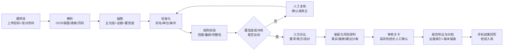
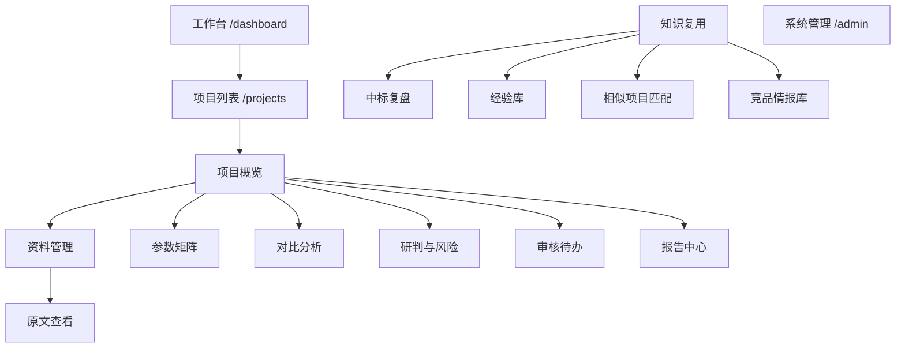

# 海外投标中的竞品标书分析系统 · 产品需求文档（PRD）

| 项目 | 内容 |
| --- | --- |
| 产品名 | BidScope（海外投标竞品标书分析系统） |
| 文档版本 | v1.0（prd1 基线版，服务页面 PRD 拆解与前端 Demo） |
| 文档状态 | 需求基线，已冻结；页面级细节见 `globaluser-<模块>-<页面>.md` |
| 编写日期 | 2026-10-24 |
| 业务方 | 沃太能源（AlphaESS）海外大储投标团队 |
| 输入依据 | ① `docs/meeting/沃太能源竞品标书AI分析调研报告.md`（与 WorkBuddy 沟通原文）<br>② `docs/meeting/海外投标竞品标书分析AI产品设计Prompt.md`（与 GPT 沟通原文）<br>③ `修改优化建议.md`（基于前两者的优化建议：中标复盘 10 方面、四类经验库、A/B/C 证据分级、5 个 Agent、5 级优先级） |
| 下游产物 | `docs/prd1/globaluser.md`（总览）、`docs/prd1/globaluser-<模块>-<页面>.md`（每页一份）、`site/`（Next.js 前端 Demo） |
| 上游沉淀 | `docs/prd/` 下 v0.2→v2.0 的演进、拆解 01–03、前端实现说明（Angular 原型验证） |
| 阅读对象 | 海外投标负责人、大储方案部、商务报价、法务合规、IT/信息安全、产品与前端团队 |

## 修订记录

| 版本 | 日期 | 说明 |
| --- | --- | --- |
| 基线 v0.1 | 2026-10-24 | 首版：角色、业务流程、功能需求、规则体系、非功能需求、版本规划 |
| 基线 v0.2 | 2026-10-24 | 15 项待确认问题收敛为「默认决策 + 变更影响」，补流程图、权限矩阵、阈值配置 |
| 基线 v2.0 | 2026-10-24 | 合并终版：纳入领域模型与原则、中标复盘与知识复用，新增实施状态对照 |
| prd1 v1.0 | 2026-10-24 | **本文件**：以 v2.0 为内容基线，按 `提示词1.md` 任务1 要求重组，补「页面清单与角色」章节（第 17 章），作为页面级 PRD 与 Next.js Demo 的唯一上游依据 |

## 阅读约定

- **【事实】** 公开资料可证实；**【假设】** 行业惯例推断，需访谈确认；**【设计】** 产品设计决策；**【示例】** 虚构演示数据。
- 优先级：**P0** MVP 必需；**P1** V1.0 必需；**P2** 增强项。
- 实施状态：`已实现` 指现有 Angular 原型（`mydemo/`）中可交互，可作为交互与数据参考；`设计完成` 指需求已定但未编码。任务4 的 Next.js 站点以本文为**需求基线**重新实现，不直接复用原型代码。
- 编号规则：`F` 功能、`BR` 业务规则、`LR` 等级变更规则、`NFR` 非功能、`US` 用户故事、`KPI` 指标。
- **页面授权**：本文第 17 章给出 8 个角色与 17 个页面（含登录页）的清单与权限矩阵；每个页面的布局、交互与真实场景内容见对应的页面级 PRD。

---

# 1. 术语

| 术语 | 说明 |
| --- | --- |
| 大储 / BESS | 大型储能系统，MW/MWh 级、电网侧或独立储能 |
| PCS / BMS / EMS | 储能变流器 / 电池管理 / 能量管理 |
| RTE | 往返效率；**必须标注测量边界**（DC-DC、PCS 端、AC-AC 全系统） |
| 测量边界 | 效率统计范围；边界不同则数值不可直接比较 |
| DoD / SoH | 放电深度 / 电池健康状态 |
| PQ / RFQ / BAFO | 资格预审 / 询价书 / 最终报价 |
| 偏离表 | 逐条声明满足或偏离的应答表，也称偏差表 |
| 五元组 | `值 + 单位 + 测试条件 + 系统层级 + 证据` —— 参数的数据契约 |
| 可比性 | 由层级、单位、条件、边界四要素机械判定的属性 |
| 金标准集 | 人工标注的标准答案集，用于评测抽取质量 |
| 置信度路由 | 按置信度把字段分派给人或直接入矩阵 |
| 门禁 Gate | 阶段推进的硬性条件 |
| A/B/C 证据分级 | A 有直接证据、B 多材料支持、C 待验证假设 |
| 履约闭环 | 用真实交付结果反向校准投标阶段的承诺与经验 |
| 经验库 | 四类可复用资产：竞品策略 / 技术响应与偏差 / 商务与交付 / 中标项目 |

---

# 2. 背景与问题定义

## 2.1 业务背景

**【事实】** 沃太能源（AlphaESS）2012 年成立于南通，业务覆盖 130+ 国家和地区，产品覆盖微型、户用、工商业、大型四大功率段；正从「户储为主」转向「户储 + 工商储 + 大储」，代表大储产品为 Aster 5000（5MWh 液冷一体化集装箱）。海外市场集中于德国、英国、意大利、捷克、澳大利亚，客户以市政公用事业（Stadtwerke）、电网公司与 EPC 为主。

**【事实】** 海外大储竞争分层明显：第一梯队 Tesla、Fluence、阳光电源、CATL；第二梯队 BYD、LGES、Siemens Energy、Wärtsilä、Powin；中国出海同侪海博思创、海辰、远景、华为等在欧洲正面竞争。

**【假设】** 投标团队在编制技术应答前必须回答三问：**业主要什么**（招标要求）、**对手承诺了什么**（竞品标书）、**我们差在哪、该怎么答**（差距与策略）。第三问的质量直接决定报价与应答，而当前主要依赖工程师逐页阅读与人脑归纳。

**【假设】** 更深一层的问题是：即使中标，经验往往停在「这个项目赢了」，没有沉淀为「在什么条件下、有几分证据、下次可以复用」。这导致同类问题跨项目重复出现。

## 2.2 现状流程（As-Is）

1. 获取竞品资料：中标公示、厂商手册、项目披露、答疑附件；
2. 工程师逐页阅读（300–800 页 × 2–4 家，多语种），手动摘录参数到 Excel；
3. 拼「招标要求 × 我方 × 竞对 A × 竞对 B」对比表；
4. 凭经验判断对手策略，形成应答与报价建议；
5. 结论以 PPT/邮件同步，评审会后归档；
6. 中标后写一份复盘报告，散落在个人电脑，人员流动即流失。

## 2.3 痛点与优先级

| 编号 | 痛点 | 频率 | 影响 | 可行性 | 优先级 |
| --- | --- | --- | --- | --- | --- |
| P-01 | 文档量大、多语种，分析以「天—周」计 | 必现 | 高 | 高 | **P0** |
| P-02 | 口径不一致（RTE 边界、寿命条件、质保假设），跨厂商不可比 | 必现 | 极高 | 中 | **P0** |
| P-03 | 漏项：偏离项、例外条款、脚注限制被忽略 | 高频 | 极高（可致废标） | 中高 | **P0** |
| P-04 | 结论不可溯源，评审会上无法对质原文 | 高频 | 高 | 高 | **P0** |
| P-05 | 情报孤岛：历史资料与中标结果不沉淀 | 必现 | 中高 | 中 | **P1** |
| P-06 | 多语种门槛，依赖个别员工 | 中频 | 中高 | 高 | **P1** |
| P-07 | 竞标与报价涉密，不可上公有云 | 必现 | 极高 | 中 | **P0（约束）** |
| P-08 | 中标经验无法复用，同类问题重复踩坑 | 必现 | 高 | 中 | **P1** |
| P-09 | 中标后承诺是否兑现无人系统核验 | 高频 | 高（亏损与信誉） | 中 | **P1** |

## 2.4 为什么现成方案不够

| 替代方案 | 不够用的原因 |
| --- | --- |
| 公有云通用大模型 | 数据出网违规；无页码级证据；表格数字易幻觉 |
| 传统全文检索 | 只能找词，不能对齐口径、不能判定符合性 |
| Excel 人工对比表 | 依赖手工摘录，不可溯源、不可复用、无法校验口径 |
| 招标文件解析类 SaaS | 输入是**招标文件**、输出是**合规标书**；本场景输入是**对手标书**、输出是**差距与策略**，视角相反 |
| 复盘报告模板 | 只产出一份 PPT，不产生可检索、可判断适用性的数据资产 |

## 2.5 产品定位与边界

> **BidScope 把「读对手标书、对齐口径、比出差距」从数天人工翻页变成数小时可溯源矩阵；再把「这一标为什么赢」拆成带证据等级、带适用范围、能被下一个项目复用的经验。它不替人做决定。**

**双闭环**

| 闭环 | 输入 | 输出 | 解决 |
| --- | --- | --- | --- |
| 投标前（ex-ante） | 竞对资料 + 招标要求 + 我方产品库 | 参数矩阵、差距清单、应答建议、澄清清单 | 这一标怎么打 |
| 投标后（ex-post） | 中标标书 + 评标反馈 + 履约结果 | 三栏证据（已证实/可能/待验证）、四类经验库、相似项目匹配 | 下一标凭什么更好 |

**本期不做**：竞品资料爬取与灰色获取；自动报价、自动承诺、自动 Go/No-Go；替代标书编制系统；通用企业知识管理平台；户储/工商储渠道零售场景。

---

# 3. 目标与成功指标

| 层级 | 目标 |
| --- | --- |
| 业务 | 缩短竞品分析周期，提升应答精准度，降低漏项与履约风险 |
| 用户 | 数小时内拿到可信、可溯源、可直接评审的差距清单 |
| 组织 | 竞品情报与中标经验从个人经验沉淀为组织资产 |

| 编号 | 指标 | 目标值 | 验证方式 |
| --- | --- | --- | --- |
| KPI-01 | 单项目竞品分析初稿时长 | ≤ 4 小时（现状 3–5 人天） | 试点计时 |
| KPI-02 / 03 | 关键参数召回率 / 准确率 | ≥ 95% / ≥ 90% | 金标准集 |
| KPI-04 | 结论可溯源率 | 100% | 抽检 |
| KPI-05 | 强制条款漏检率 | ≤ 2% | 金标准集 |
| KPI-06 | 无引用断言率 | ≤ 1% | 抽检 |
| KPI-07 | 经验复用率（新项目引用经验数 / 可用经验数） | ≥ 40% | 系统埋点 |
| KPI-08 | 承诺兑现率（履约 met+partial / 已核验记录） | ≥ 90% | 履约记录统计 |

> 上述均为**待验证目标值**，不作为承诺收益。

---

# 4. 用户角色与需求

## 4.1 角色清单

| 角色 | 类型 | 核心诉求 | 主要页面 |
| --- | --- | --- | --- |
| 技术投标工程师 / 大储方案工程师 | **主用户** | 参数抽对、口径一致、证据可查 | 资料、参数矩阵、对比分析 |
| 投标经理 | **主用户** | 赢面与风险判断、结论可评审、复盘可交付 | 工作台、研判、审核、报告、中标复盘 |
| 商务 / 报价 | 次用户 | 对手商务条款、报价结构与差异卖点 | 对比分析（商务维度）、复盘商务 Tab |
| 产品经理 / 系统工程师 | 次用户 | 跨项目差距排序产品改进 | 对比分析、经验库 |
| 区域销售总监 / 管理层 | **决策人** | 5 分钟读懂竞争态势与待决策项 | 报告中心（一页简报） |
| 法务 / 合规 | 次用户 | 红旗条款、承诺风险、合同边界 | 研判风险清单、复盘履约 Tab |
| 知识库管理员 | 支撑 | 经验入库质量与等级审批 | 经验库、系统管理 |
| 系统管理员 / IT 安全 | 支撑 | 权限、审计、部署与模型配置 | 系统管理 |

## 4.2 角色画像

**李工 · 技术投标工程师**：电气/电化学背景，3–8 年经验，同时跟 2–3 个项目，窗口期 2–4 周。最怕「效率边界没对齐就写进偏离表」。诉求是**宁可系统说不知道，也不要编一个数字**；每个数字点一下能看到原文。

**王经理 · 投标经理**：关心赢面、风险、报价让不让、何时定稿。痛点是要一页纸但底下给 20 页表格；评审会上被问「数据哪来的」答不上。诉求是一页式简报 + 证据链 + 谁在何时改了什么。

**赵总 · 管理层决策人**：关心这标值不值得投、胜负手是技术还是价格、要什么授权。诉求是 5 分钟读完的态势摘要，风险红黄绿，AI 给事实不给结论。

## 4.3 用户故事

| 编号 | 角色 | 故事 | 优先级 | 状态 |
| --- | --- | --- | --- | --- |
| US-01 | 投标经理 | 为投标项目建工作台并上传招标与多家竞对资料，团队在同一处协作 | P0 | 已实现 |
| US-02 | 工程师 | 系统自动抽取大储关键参数并标出页码，我只复核不确定的部分 | P0 | 已实现 |
| US-03 | 工程师 | 看到每个参数的原始值、单位、测试条件与标准化值，判断能否比较 | P0 | 已实现 |
| US-04 | 工程师 | 一张「要求 × 我方 × 竞对」三向对比表，明确标出满足/偏离/证据不足 | P0 | 已实现 |
| US-05 | 工程师 | 口径不同时系统拒绝直接比较并说明原因，而不是给一个排名 | P0 | 已实现 |
| US-06 | 工程师 | 低置信度字段逐个确认或修正，修正结果影响后续结论 | P0 | 已实现 |
| US-07 | 投标经理 | 结论发布前审核高风险项，AI 不越权对外承诺 | P0 | 已实现 |
| US-08 | 投标经理 | 一键导出差距清单、澄清清单与 Excel 对比表进入标书编制 | P1 | 已实现 |
| US-09 | 管理层 | 一页式竞争态势简报，每个结论带证据入口 | P1 | 已实现 |
| US-10 | 商务 | 按商务维度对比质保、账期、交付、保函条款 | P1 | 已实现 |
| US-11 | 投标经理 | 从中标项目里按 A/B/C 拆出「已证实优势 / 可能原因 / 待验证假设」 | P1 | 已实现 |
| US-12 | 知识库管理员 | 经验入库前按 12 字段与证据来源校验，并可审批等级变更 | P1 | 已实现 |
| US-13 | 工程师 | 新项目自动匹配相似历史项目，区分「可借鉴」与「条件不同」 | P1 | 已实现 |
| US-14 | 法务 | 看到履约未达成的项目，并据此触发相关经验降级 | P1 | 已实现 |
| US-15 | 产品经理 | 跨项目累积「我方劣势 Top N」排产品改进优先级 | P2 | 设计完成 |

## 4.4 典型场景

1. **快速摸底**：新建 CZ 项目，上传招标书 + 3 家竞对资料，10 分钟出矩阵，复核 12 个低置信度字段，导出差距清单。
2. **口径仲裁**：商务质疑「对手 RTE 92%、我们 88%」，系统显示边界不同判为不可比，附两处原文，3 分钟闭环。
3. **中标复盘**：项目中标后 2 周内完成复盘，把「交付记录比承诺有说服力」定为 A 级经验。
4. **相似匹配**：新项目 CZ 100MWh，系统匹配到 CZ 320MWh 项目（75 分），同时列出「规模差 3 倍」这一差异条件。
5. **履约回写**：UK 项目因海运延误触发赔付，履约记录标为未达成，系统自动把该项目 A 级经验降为 B 并要求复核。

---

# 5. 业务流程

## 5.1 海外大储投标端到端流程

| # | 环节 | 角色 | 输入 | 输出 | 现存痛点 | AI 介入点 |
| --- | --- | --- | --- | --- | --- | --- |
| 1 | 商机筛选 | 销售、投标经理 | 询价、公告 | 立项单 | 情报零散 | 竞品历史中标摘要（P2） |
| 2 | 招标文件解析 | 投标经理、工程师 | RFP、规范书、合同草案 | 强制条款清单 | 强制项易漏 | 强制条款识别与分级（P1） |
| 3 | 技术符合性初判 | 工程师 | 要求 + 我方资料 | 初判表 | 需查手册 | 我方产品库对齐（P1） |
| 4 | 竞对识别与资料收集 | 投标经理 | 客户信息、公开渠道 | 竞对资料包 | 来源可靠性难判 | 来源可靠性标注（P0） |
| 5 | **竞品标书分析（核心）** | 工程师 | 竞对标书/手册 | 参数矩阵 | 慢、漏、口径不一 | 解析→抽取→标准化→对比（P0） |
| 6 | 三方对标与归因 | 工程师、产品经理 | 要求 + 我方 + 竞对 | 差距清单 | 归因主观 | 加权对比与归因建议（P0） |
| 7 | 技术应答与偏离表 | 工程师 | 差距清单 | 偏离表 | 重复劳动 | 偏离表初稿（P1） |
| 8 | 商务报价协同 | 商务、投标经理 | 差距、成本模型 | 报价单 | 技术商务脱节 | 商务条款对比（P1） |
| 9 | 内部评审审批 | 全员 | 简报、清单 | 评审纪要 | 结论不可溯源 | 证据链与批注（P0） |
| 10 | 投标与复盘 | 全员 | 评标结果 | 复盘与入库 | 知识不沉淀 | 结果回写（P1） |

## 5.2 投标前竞品分析子流程（To-Be）



## 5.3 投标后复盘闭环（To-Be）


## 5.4 阶段门禁

| 阶段 | 产物 | 推进条件 |
| --- | --- | --- |
| 摄取 | 结构化文档树 + 页码映射 | 招标文件已标注；每份文档有来源可靠性 |
| 抽取 | 参数草稿矩阵 | 每字段带证据引用，否则记为抽取失败 |
| 校验 | 标准化矩阵 + 冲突清单 | 条件缺失项不得标记为可比 |
| 对比 | 判定矩阵 | Mandatory 项全部有判定 |
| 研判 | 结论卡片 + 风险清单 | 已确认字段达阈值；承诺项为占位符 |
| 复盘 | 三栏证据 + 经验条目 | 经验 12 字段齐全；证据等级与来源一致 |

---

# 6. 核心功能

## 6.1 功能架构

```
BidScope
├── 投标前（F1–F10）
│   ├── F1 项目工作台     F2 文档导入解析    F3 参数抽取
│   ├── F4 标准化与校验   F5 对比与差距      F6 研判与风险
│   ├── F7 审核与协作     F8 报告生成        F9 竞品情报库
│   └── F10 系统管理与安全
└── 投标后（F11–F13）
    ├── F11 中标复盘（三栏证据 + 评分因素 + 履约验证）
    ├── F12 经验库（四类资产 + A/B/C 分级 + 等级审批）
    └── F13 相似项目匹配（可借鉴 vs 差异条件 + 引用留痕）
```

## 6.2 优先级总览

| 功能 | 名称 | 优先级 | 状态 |
| --- | --- | --- | --- |
| F1 | 项目工作台 | P0 | 已实现 |
| F2 | 文档导入与解析 | P0 | 已实现 |
| F3 | 参数抽取 | P0 | 已实现 |
| F4 | 标准化与规则校验 | P0 | 已实现 |
| F5 | 对比与差距分析 | P0 | 已实现 |
| F6 | 研判与风险 | P1 | 已实现 |
| F7 | 人工审核与协作 | P0 | 已实现 |
| F8 | 报告生成与导出 | P1 | 已实现 |
| F9 | 竞品情报库 | P1 | 已实现 |
| F10 | 系统管理与安全 | P0 | 已实现 |
| F11 | 中标复盘 | P1 | 已实现 |
| F12 | 经验库与等级审批 | P1 | 已实现 |
| F13 | 相似项目匹配 | P1 | 已实现 |

## 6.3 投标前功能（F1–F10）

| 功能 | 用户目标 | 关键输入 | 系统逻辑 | 输出 | 异常处理 | 验收标准 |
| --- | --- | --- | --- | --- | --- | --- |
| **F1 项目工作台** | 多项目并行不串味，30 秒看清状态 | 项目信息、成员、截止日 | 项目级数据隔离；五阶段加权进度；截止前 48h 提醒 | 项目档案、进度看板、待办 | 无招标文件时禁用「提交审核」 | 建项目 ≤3 步；跨项目零可见 |
| **F2 文档解析** | 多格式多语种变可定位文本 | PDF/Word/Excel/PPT/图片 | 病毒扫描→哈希→版本；OCR+版面；跨页表格重建；页码映射 | 结构化文档树、解析质量报告 | 缺页/低 OCR/加密/超大文件分别提示 | 30 页 ≤60s；字段 100% 可回跳原文 |
| **F3 参数抽取** | 按字典抽参数且每个数字可核实 | 结构化文档、参数字典 | 混合抽取（表格走规则+正则，叙述走 LLM+Schema）；强制引用；条件必填 | 参数草稿矩阵、冲突清单、待确认清单 | 图示参数不强行读数；单位缺失降级；异常值拦截 | 召回 ≥95%、准确 ≥90%；无引用字段不入矩阵 |
| **F4 标准化校验** | 让不同口径可比，让「不可比」有依据 | 参数草稿、字典、规则库 | 别名映射、单位换算（确定性代码）、条件归一、量纲与合理性校验 | 标准化矩阵、变更日志、不可比清单 | 单位未知不换算；条件不可归一判不可比 | 换算正确率 100%；每项可查看换算过程 |
| **F5 对比差距** | 一张表看清要什么、对手给什么、我们差在哪 | 标准化矩阵、招标要求、我方资料 | 三向对齐；六态判定；Mandatory 置顶；加权热力图；四类差距归因 | 对比矩阵、差距清单、废标风险清单、不可比理由、澄清清单 | 要求表述模糊→列入澄清；竞对单一→提示样本不足；权重未知→等权并标注 | 判定可展开规则命中；强制条款 100% 进风险清单；不可比项禁止排名 |
| **F6 研判风险** | 得到「所以呢」，但事实与推断分离 | 已确认对比结果 | 三段式结论（结论/依据/类型）；只读已确认数据；风险分级 | 结论卡片、风险清单、澄清草稿 | 已确认不足 15 项拒绝生成；无引用结论丢弃并计数；涉报价承诺置占位 | 结论 100% 带引用或标待核实；报价承诺零自动输出 |
| **F7 审核协作** | 人的判断是唯一生效路径且留痕 | 待审字段、待审结论 | 置信度路由；10 条触发规则；双人规则；版本 diff | 审核记录、字段最终值、版本快照 | 超时升级；自审拦截；驳回重跑不变提示人工录入 | 高风险 100% 可追溯审批人；无自审通过 |
| **F8 报告导出** | 一次分析服务三种受众 | 已发布快照 | 5 类模板；快照渲染；引用角标；水印；脱敏模式 | Excel/Word/PDF、证据索引、简报 | 含未审项阻止导出；大表异步生成 | 每条结论可回链字段；导出 100% 记录审计 |
| **F9 竞品情报库** | 竞对资料与历史参数可检索复用 | 已发布版本的竞对确认值 | 双库分离（企业库/项目库）；入库需审核；多值并存带时间；18 个月有效期 | 竞对档案、参数时间线、复用建议 | 入库撤回保留痕迹；过时数据提示 | 每条参数可溯源；过时数据不默认推荐 |
| **F10 系统管理** | 满足保密与合规底线 | 用户、角色、字典、阈值 | RBAC+项目 ACL；数据分级；审计日志；模型配置 | 权限矩阵、字典版本、阈值配置、审计报告 | 管理员读正文被拒并告警 | 越权 100% 拦截；敏感操作 100% 留痕 |

## 6.4 投标后功能（F11–F13）

| 功能 | 用户目标 | 关键输入 | 系统逻辑 | 输出 | 异常处理 | 验收标准 |
| --- | --- | --- | --- | --- | --- | --- |
| **F11 中标复盘** | 把「为什么赢」拆成可检验的证据 | 中标标书、评标反馈、澄清纪要、履约结果 | 评分因素拆解；A/B/C 分级；三栏呈现；履约验证联动降级 | 三栏证据、评分因素表、方案商务复盘、履约记录 | 无评分表项目 A 级降级展示并告警；C 级禁止作为结论 | 三栏可辨（形状+图标+文字）；未达成履约可一键触发降级 |
| **F12 经验库** | 四类资产可检索、可判断适用性 | 复盘产物 | 12 必填字段校验；A/B/C 徽标；入库审核；等级变更申请与审批；引用留痕 | 经验条目、变更历史、引用记录 | 缺字段禁止入库；升级缺证据拒绝；无评分表禁止升 A；本人发起不可自审 | 12 字段缺一不可入库；变更历史完整可追溯 |
| **F13 相似项目匹配** | 找到相似项目并说明哪些能借、哪些不能 | 当前项目五要素、经验库 | 五维加权（国别 30/规模 25/路线 15/客户 15/合同 15）；可借鉴与差异条件分区 | 匹配度、命中条件、差异条件、可借鉴经验、待验证假设 | 匹配度不单独作结论；C 级只进假设区；引用需二次确认 | 同时展示可借鉴与差异；C 级不出现在可借鉴区 |

## 6.5 交互流程（单项目 journey）

1. 建项目并上传招标 + 竞对资料，标注来源可靠性；
2. 分钟级解析与抽取，生成带页码引用的参数草稿；
3. 复核低置信度与冲突项，修正回流知识库；
4. 一键生成三向矩阵、差距热力图、废标风险清单；
5. 研判生成三段式结论与风险清单，人工采纳/驳回；
6. 评审会基于证据链决策，管理层填写报价与承诺边界；
7. 发布报告快照并导出，进入标书编制；
8. 中标后 2 周内完成复盘，经验入库并标注等级；
9. 下一个项目自动匹配相似历史项目并引用经验，引用留痕。

---

# 7. 参数体系与判定规则

## 7.1 参数字典（48 项，6 维度）

| 维度 | 代表参数 | 必带条件 |
| --- | --- | --- |
| 技术 | 额定功率/能量、可用能量、时长、DC/AC 比、占地、重量、电芯类型、温控、IP、噪声 | 可用能量需 DoD、SoH |
| 性能 | 系统 RTE、PCS 效率、辅助功耗、待机损耗、循环寿命、衰减、日历寿命、温度区间、降额、响应时间 | RTE 需边界/温度/负载；循环需 DoD/温度/SoH |
| 安全 | 消防方案、认证清单、并网标准、LVRT、THD、功率因数、防孤岛 | 认证需型号与有效期 |
| 质保 | 可用率、质保年限、延保、容量保证 | 可用率需统计周期 |
| 交付 | 交付周期、本地服务、运维模式、备件、调试、培训 | 交付需起算点 |
| 商务 | 报价结构、付款条件、履约保函、LD、保险、币种、调价、税务、维保涨价 | — |

## 7.2 五元组与可比性

```
ParameterValue = { value, unit, conditions, level, evidence }
comparable(a,b) = a.defKey==b.defKey && a.level==b.level
               && a.unit ~= b.unit && conditionsAligned(a,b)
```

任一不满足 → `incomparable`，界面必须输出差异说明，**禁止排名**。

## 7.3 判定六态

| 状态 | 含义 | 优先级 | 可排名 |
| --- | --- | --- | --- |
| `deviation` | 明确偏离 | 1 | 是 |
| `incomparable` | 无法直接比较 | 2 | **否** |
| `potentialDeviation` | 潜在偏离 | 3 | 是（带提示） |
| `noResponse` | 未应答 | 3 | 否 |
| `insufficientEvidence` | 证据不足 | 4 | 否 |
| `undisclosed` | 未披露 | 5 | 否 |
| `compliant` | 满足 | 6 | 是 |

## 7.4 业务规则汇总

| 编号 | 规则 |
| --- | --- |
| BR-01 | 证据优先：数值必须可跳转原文，无证据字段降权显示并标「无引用」 |
| BR-02 | 缺失不等于零：未抽到/未披露不带值，禁止 0 填充 |
| BR-03 | 未披露不等于不具备，不计入劣势统计 |
| BR-04 | 不可比不排名，只出分维度对比 |
| BR-05 | 强制条款置顶：Mandatory 非 compliant 即入废标风险清单 |
| BR-06 | 决策留白：报价、承诺、Go-No-Go 只出占位与依据 |
| BR-07 | 冲突不消解：多值全部保留，人工裁决并填理由 |
| BR-08 | 双人规则：高风险项禁止编辑人自审 |
| BR-09 | 修正可审计：原值/新值/人/时间/理由/版本全留痕 |
| BR-10 | 置信度路由：≥0.85 免检抽检；0.60–0.85 提示复核；<0.60 强制人工 |
| BR-11 | 经验必须带证据等级与来源，无来源不得入库 |
| BR-12 | C 级只能出现在「待验证假设」区，不得作为结论 |
| BR-13 | 无正式评分表的项目，经验最高只能评 B 级 |
| BR-14 | 履约未达成 → 对应经验自动降级并退回复核 |
| BR-15 | 引用经验必须留痕（谁、何时、哪条、用于何处） |

## 7.5 证据分级与等级变更

| 级别 | 定义 | 典型证据 | 决策用途 |
| --- | --- | --- | --- |
| A | 有直接证据 | 评分表得分、客户邮件认可、评标反馈 | 可写入策略建议 |
| B | 多材料支持 | 投标文件 + 澄清 + 谈判记录 | 可参照，须注明限制 |
| C | 待验证假设 | 只有结果无因果证据 | 仅标假设，禁止结论 |

**等级变更规则（LR）**

| 编号 | 规则 |
| --- | --- |
| LR-01 | 升级必须新增至少一条证据来源 |
| LR-02 | 升到 A 级必须有直接证据，且项目须有正式评分表（否则按 BR-13 拒绝） |
| LR-03 | 变更理由 ≥6 字并写入审计 |
| LR-04 | 双人规则：不可审批本人发起的变更 |
| LR-05 | 单条经验同时只允许一个待审变更 |
| LR-06 | 通过后追加证据来源并置「已核验」；已停用条目不改状态 |
| LR-07 | 降级可不附证据，但须写明原因，同样走审批 |
| LR-08 | 全部变更进入历史（发起人、时间、理由、证据、审批人、审批意见） |

# 8. 交互与页面

## 8.1 信息架构



## 8.2 路由与页面

| 路由 | 页面 | 主要数据 | 关键交互 | 状态 |
| --- | --- | --- | --- | --- |
| `/dashboard` | 工作台 | 项目、待办、风险、审计 | KPI 跳转、新建项目校验、风险筛选 | 已实现 |
| `/projects` | 项目列表 | 项目、风险计数 | 卡片/表格切换、排序、筛选 | 已实现 |
| `/projects/:id/overview` | 项目概览 | 门禁、完整性、判定分布 | 阶段门禁、发布阻断提示 | 已实现 |
| `/projects/:id/documents` | 资料管理 | 文档、解析异常 | 上传抽屉、重试、异常处理 | 已实现 |
| `/projects/:id/documents/:docId` | 原文查看 | 页面文本、锚点 | 锚点↔正文双向定位、上一处/下一处、修正建议 | 已实现 |
| `/projects/:id/parameters` | 参数矩阵 | 60 参数实例 | 置信度 chip、行内修正、冲突裁决、批量确认、CSV | 已实现 |
| `/projects/:id/comparison` | 对比分析 | 42 对比行 | 行展开规则命中、四要素可比性、权重校验、热力图、禁止排名提示 | 已实现 |
| `/projects/:id/insights` | 研判与风险 | 12 结论、8 风险、6 澄清 | 采纳/驳回、风险分组、澄清复制、决策留白 | 已实现 |
| `/projects/:id/reviews` | 审核待办 | 9 任务 | diff 审核、双人规则拦截、指派 | 已实现 |
| `/projects/:id/reports` | 报告中心 | 5 模板、3 快照 | 模板预览、发布门禁、导出、水印 | 已实现 |
| `/retro`、`/retro/:retroId` | 中标复盘 | 4 项目、15 因素、10 履约 | 四 Tab、证据三栏、履约降级 | 已实现 |
| `/experience` | 经验库 | 12 经验、3 变更记录 | 四类 Tab、12 字段抽屉、入库审核、等级申请/审批 | 已实现 |
| `/match` | 相似项目匹配 | 匹配结果、引用记录 | 项目切换、可借鉴 vs 差异、引用确权 | 已实现 |
| `/library` | 竞品情报库 | 6 竞对、历史参数 | 档案、时间线、过时标记、检索高亮 | 已实现 |
| `/admin` | 系统管理 | 8 用户、48 字典、30 审计 | 权限矩阵、字典增改、阈值校验、审计筛选导出 | 已实现 |
| `/**` | 404 | — | 返回入口 | 已实现 |

## 8.3 页面规格要点（摘要）

| 页面 | 必须包含 | 空态 / 异常态 |
| --- | --- | --- |
| 工作台 | 4 KPI、5 待办、项目卡、风险分级、最近 8 条活动 | 无项目引导；加载骨架 |
| 参数矩阵 | 置信度 chip（待确认/强制人工/冲突/已修正/无引用）、筛选、行内编辑、冲突裁决弹窗 | 无匹配给清空筛选 |
| 对比分析 | 废标风险摘要、维度权重、三向矩阵、行展开规则命中、热力图 | 无竞对提示；权重默认告警 |
| 研判 | 三段式卡片、风险分级、待澄清、决策留白 | 未达门禁禁用生成并列出缺口 |
| 审核 | 任务列表 + diff、理由快捷项、双人规则提示 | 无待办展示最近处理 |
| 报告 | 5 模板、预览、发布门禁、快照列表 | 未审项阻止导出 |
| 中标复盘 | 三栏证据、评分因素表、方案商务、履约验证 | 无评分表告警；C 级禁止结论提示 |
| 经验库 | 6 统计、四类 Tab、10 列表格、13 字段抽屉、等级变更区块 | 缺字段禁止入库并列出缺失 |
| 相似匹配 | 项目选择、权重说明、匹配卡片（命中/差异）、引用记录 | 无匹配给说明 |

## 8.4 设计原则

1. **证据先行**：无证据数值灰显 +「无引用」标签，不做视觉强化；
2. **三重编码**：状态一律「颜色 + 图标 + 文字」，A/B/C 用形状区分（实线/双线/虚线）；
3. **AI 产出永远是草稿**：文案统一为「建议/草稿/待确认」；
4. **拒绝静默失败**：解析、抽取、规则未命中均显式告知；
5. **一屏一主行动**：每页仅一个 primary 按钮；
6. **风格**：Minimalism / Swiss —— 单色骨架 + 单一强调色、1px 边框分层、圆角 0、无投影（弹层除外）、数字等宽、**全站零 emoji**（图标为内联 SVG）。

---

# 9. AI 能力与人机协作

## 9.1 分工边界

| 任务 | 承担者 | 理由 |
| --- | --- | --- |
| 版面分析、OCR、章节切分 | 解析模型 + 规则 | 确定性较强可评测 |
| 表格数字识别 | 规则 + OCR 双引擎校验 | 数字错误代价极高 |
| 叙述性参数抽取、条款理解 | LLM（Schema 约束 + 强制引用） | 长文本语义是模型优势 |
| 单位换算、阈值判定、加权计算 | **确定性代码** | 必须可测试可审计 |
| 冲突检测、完整性校验 | 规则引擎 | 需 100% 可复现 |
| 差距归因、优势归纳、草稿生成 | LLM（标注推断） | 需要归纳表达 |
| 报价、承诺、Go/No-Go、证据定级 | **人** | 责任与授权边界 |

## 9.2 Agent 角色

| Agent | 职责 | 不做什么 |
| --- | --- | --- |
| 编排 Agent | 按状态机调度子任务、重试、汇总 | 不产出业务结论 |
| 解析 Agent | 格式识别、OCR、表格重建、章节分类 | 不做参数判断 |
| 抽取 Agent | 按字典抽取 + 引用 + 置信度 | 不猜条件、不补单位 |
| 校验 Agent | 调规则引擎，输出错误与冲突 | 不做语义推断 |
| 对比 Agent | 三向对齐、状态判定、加权 | 不自行改权重、不排名 |
| 研判 Agent | 生成三段式结论草稿 | 不引用未确认字段、不生成报价承诺 |
| 质检 Agent | 引用抽检、数值一致性比对 | 只标记，不改业务数据 |
| **复盘 Agent** | 对照标书/评分/澄清/履约产出三栏证据与经验草稿 | 不自行定级（等级由人确认） |
| **匹配 Agent** | 按五要素检索历史项目，解释可借鉴与差异 | 不把匹配度当结论 |
| **风险偏差 Agent** | 检查当前项目是否重复历史证书缺失、口径不一致、交付风险 | 命中项交人确认 |

## 9.3 人机协作三道关卡

| 关卡 | 时机 | 人做什么 | 系统提供 |
| --- | --- | --- | --- |
| 关卡 1 解析/抽取 | 文档处理完成 | 复核低置信度与冲突项 | 置信度排序、原文对照、批量确认 |
| 关卡 2 结论审核 | 研判草稿生成后 | 审核高风险结论、证据定级 | diff、引用证据、理由快捷项 |
| 关卡 3 发布授权 | 导出/对外前 | 投标经理批准，责任人签字 | 未审项阻断、版本快照 |

**反馈闭环**：人工修正 → 修正日志 → 金标准集 → 调优字典/提示词/阈值 → 复核工作量下降（KPI-07 跟踪）。

---

# 10. 非功能需求

| 编号 | 类别 | 要求 |
| --- | --- | --- |
| NFR-01 | 部署 | 私有化/专有云；模型推理不出内网；提供离线安装包 |
| NFR-02 | 性能 | 100 页解析 ≤3 分钟；300 页 ≤8 分钟；对比表首屏 ≤3 秒；并发 50 |
| NFR-03 | 可用性 | 工作时间 ≥99.5%；任务可重试；单文件失败不影响批次 |
| NFR-04 | 安全 | TLS + 存储加密；文档水印；导出审批；禁止内容外发（可配置白名单并审计） |
| NFR-05 | 权限 | RBAC + 项目 ACL；跨项目零可见；管理员操作二次确认且不可读正文 |
| NFR-06 | 审计 | 敏感操作全留痕、不可篡改、保留 ≥3 年 |
| NFR-07 | 隔离 | 项目间逻辑隔离；知识库入库需审批；删除为软删除 + 审计 |
| NFR-08 | 可维护 | 字典、规则、提示词版本化，支持灰度与回滚 |
| NFR-09 | 扩展 | 预留 CRM/PLM/OA/标书系统 API 与 SSO |
| NFR-10 | 国际化 | 界面中文；文档支持中英德荷西意解析 |
| NFR-11 | 兼容 | Chrome/Edge 最新两版；PDF 渲染支持合法解密版本 |
| NFR-12 | 成本 | 任务分级选模型；缓存；成本看板与预算告警 |

---

# 11. 数据与集成

| 编号 | 需求 | 说明 |
| --- | --- | --- |
| D-01 | 我方产品资料库 | 规格书、认证、历史应答、标准条款（需版本维护） |
| D-02 | 竞品资料 | 仅合法来源（官方手册、公开公示），记录来源与可靠性 |
| D-03 | 招标文件与评标规则 | 强制条款标记、评分权重（未公开时人工录入） |
| D-04 | 术语与别名词典 | 大储中英德术语表，持续维护 |
| D-05 | 历史项目与履约数据 | 复盘与金标准集来源，需脱敏与授权 |
| D-06 | 经验库 | 四类资产 + 12 必填字段 + 证据等级 + 变更历史 |
| I-01 | SSO/组织架构 | LDAP/OAuth2 |
| I-02 | 标书编制系统 | 导出偏离表初稿（Excel/结构化 API） |
| I-03 | OA/IM | 待办与风险告警推送 |
| I-04 | 成本模型 | 报价参考仅展示区间来源，不自动取数 |

---

# 12. 验收与指标

## 12.1 功能验收（关键项）

| 编号 | 验收项 | 通过标准 |
| --- | --- | --- |
| A-01 | 三向矩阵正确性 | 关键 30 项与专家判定一致率 ≥90% |
| A-02 | 证据溯源 | 抽检 50 字段 100% 定位正确 |
| A-03 | 口径拦截 | 边界不同判「不可比」且不排名 |
| A-04 | 缺失值处理 | 状态为未披露/证据不足，无 0 填充 |
| A-05 | 高风险拦截 | 未审核前无法导出/发布 |
| A-06 | 权限隔离 | 跨项目访问 100% 拒绝并记审计 |
| A-07 | 冲突保留 | 多值全部保留并需人工决策 |
| A-08 | 经验入库 | 缺 12 字段任一不可入库，错误定位字段 |
| A-09 | 证据定级 | 无评分表项目 A 级被禁用并说明 |
| A-10 | 等级审批 | 本人发起不可自审；通过后等级与证据同步 |
| A-11 | 匹配可用性 | 同时展示可借鉴与差异；C 级不进可借鉴区 |
| A-12 | 履约降级 | 未达成履约触发经验降级且不丢其他项目数据 |

## 12.2 指标定义

| 编号 | 指标 | 计算 | 目标 |
| --- | --- | --- | --- |
| KPI-01 | 抽取准确率 | 与金标准完全一致字段 / 已抽字段 | ≥90% |
| KPI-02 | 抽取召回率 | 已抽到 / 金标准应有 | ≥95% |
| KPI-03 | 证据定位准确率 | 引用正确 / 抽检 | ≥98% |
| KPI-04 | 标准化正确率 | 与专家一致 / 抽检 | 单位 100%、条件 ≥95% |
| KPI-05 | 强制条款漏检率 | 漏判 / 强制条款总数 | ≤2% |
| KPI-06 | 对比判定正确率 | 与专家一致行数 / 抽检行数 | ≥90% |
| KPI-07 | 人工复核率 | 进待办字段 / 总字段 | 首月 ≤40%，三个月 ≤25% |
| KPI-08 | 单项目处理时长 | 建项目到发布报告 | ≤4 小时 |
| KPI-09 | 报告采纳率 | 未修改直接使用的结论 / 总条数 | ≥70% |
| KPI-10 | 无引用断言率 | 无证据结论 / 总结论 | ≤1% |
| KPI-11 | 经验复用率 | 被引用经验 / 可用经验 | ≥40% |
| KPI-12 | 审计覆盖率 | 已记录敏感操作 / 全部敏感操作 | 100% |

---

# 13. 版本规划

| 阶段 | 周期 | 范围 | 交付物 |
| --- | --- | --- | --- |
| MVP | 0–8 周 | 项目、摄取、抽取、基础标准化、对比、审核、权限、CSV | 试点可用（1 项目 / 4 文档 / 30 参数） |
| V1.0 | 9–16 周 | 完整字典 60+、规则库、热力图、Word/PDF 报告 | 团队全员 |
| V1.5 | 17–24 周 | 研判生成、风险清单、版本 diff、法务/商务视图 | 决策支持 |
| V1.6 | 并行 | 中标复盘、A/B/C 分级、经验库、等级审批、相似匹配 | 知识复用 |
| V2.0 | 6–12 月 | 语义检索、中标结果回写、履约自动核验、SSO/IM/标书系统集成 | 平台化 |

**当前进度**：前端 Demo 已把 MVP→V1.6 的 16 条路由全部可视化（纯 Mock，无后端），用于评审与开发对齐。

---

# 14. 风险与对策

| 编号 | 风险 | 影响 | 对策 |
| --- | --- | --- | --- |
| R-01 | 数据泄密 | 极高 | 私有化、模型不出网、分级权限、水印、导出审批、审计告警 |
| R-02 | 模型幻觉 | 高 | 强制引用、无引用即丢弃、质检 Agent、推断标签、人工关卡 |
| R-03 | OCR/表格错误 | 高 | 双引擎校验、异常值规则、低置信度强制人工 |
| R-04 | 条件不同导致错误比较 | 极高 | 条件必填、不可比状态、禁止排名、口径差异提示 |
| R-05 | 竞品资料缺失或来源不可靠 | 中高 | 来源等级、证据不足状态、不以未披露推断劣势 |
| R-06 | 资料获取合法性 | 高 | 仅接受合法来源并登记，系统不提供爬取 |
| R-07 | Prompt Injection | 中高 | 文档内容仅作数据、指令白名单、输出结构校验、异常告警 |
| R-08 | Agent 越权 | 高 | 工具最小权限、高风险动作需人确认、接口层二次鉴权 |
| R-09 | 错误结论入库并复用 | 高 | 入库审核、双库分离、撤回机制、过时提示 |
| R-10 | 用户不信任 | 高 | 从「省时间的对比表」切入，证据可点，先赢日常 |
| R-11 | 多语言术语误译 | 中 | 术语词典优先、型号不翻译、关键条目显示原文 |
| R-12 | 成本与延迟 | 中 | 分层用模型、缓存、异步、预算告警 |
| R-13 | 供应商锁定 | 中 | 模型适配层抽象，支持本地模型替换 |
| R-14 | **经验等级被滥用**（把 C 当 A 用） | 高 | 等级审批双人规则、C 级单列假设区、引用二次确认、定期抽检 |
| R-15 | 匹配结果被误用为「照抄模板」 | 中高 | 差异条件比命中条件更醒目、匹配度不作结论、引用留痕 |

---

# 15. 待确认问题与默认决策

| 编号 | 问题 | 默认决策 | 若不同则影响 |
| --- | --- | --- | --- |
| D-01 | 角色划分与人数 | 技术投标工程师为独立岗位，7 角色建模 | 需强化批量操作，MVP +20% |
| D-02 | 竞品分析窗口 | T-10 至 T-3，现状 3–5 人天 | 影响 KPI-01 基线与预解析策略 |
| D-03 | 审批链级数 | 两级（投标经理技术 + 区域总监商务） | 三级需审批流引擎，+3 周 |
| D-04 | 已有系统 | 不对接，先导出型集成 | 若已有投标系统，需前置联调 +4 周 |
| D-05 | 竞品资料渠道 | 仅用户上传，来源四档，无爬虫 | 允许采集需新增合规模块 |
| D-06 | 数据分级 | 竞对标书=机密，报价=绝密，导出需审批水印 | 需对接 DLP |
| D-07 ⚠️ | 外部云模型 | 默认全内网本地模型，外部仅脱敏+白名单+审计 | 禁止外部调用则受算力约束（关键风险） |
| D-08 | 历史资料存量 | 自建金标准集，不依赖历史库 | 历史可用则知识库提前 |
| D-09 ⚠️ | 强制条款与权重 | 内置 4 类约 40 条模板 + 等权，项目内人工调 | 权重直接决定「胜负手」可信度 |
| D-10 | 区域标准差异 | 内置德/英/意/捷/澳标签，仅提示不判定 | 判定合规需法务确认 |
| D-11 ⚠️ | 内部口径 | RTE=AC-AC 含辅助；寿命 DoD90/25℃/SoH70；可用率=年度时间加权 | 口径变化导致历史结论不可比 |
| D-12 | 我方参数维护 | 大储方案部 1 名 Owner 季度更新 | 无 Owner 则我方列不可信 |
| D-13 | 内网算力 | 单机 2×GPU + 容器化 + IT 托管 | 不足则限制并发与模型规格 |
| D-14 | SSO 与审计 | OAuth2/LDAP，日志 3 年不可篡改 | 等保三级需额外改造 |
| D-15 | 报表与接口 | Excel + Word + PDF，REST + 文件导出 | 需结构化 Schema 时提前定义 |
| D-16 | 复盘责任人 | 投标经理牵头，技术+商务+法务各出 1 人 | 无责任人则经验库荒废 |
| D-17 | 履约数据来源 | 人工录入，季度核验 | 可对接交付系统则自动回写 |

---

# 16. 附录

## A. 实施状态对照（PRD ↔ Demo）

| 能力 | PRD 章节 | Demo 落点 | 边界 |
| --- | --- | --- | --- |
| 项目/资料/参数/对比/研判/审核/报告 | 6.3 | 10 条路由 | 数据为 Mock，解析与抽取为模拟 |
| 竞品情报库 | F9 | `/library` | 只读演示，过时标记可见 |
| 系统管理 | F10 | `/admin` | 权限矩阵可交互但不做真实鉴权 |
| 中标复盘 | 6.4 F11 | `/retro` | 复盘数据为虚构样例 |
| 经验库与等级审批 | 6.4 F12 | `/experience` | 审批在前端内存完成，无账号体系 |
| 相似项目匹配 | 6.4 F13 | `/match` | 五维规则加权，非向量召回 |
| 履约闭环 | 6.4 F11 | `/retro` 履约 Tab | 履约数据人工录入 |

## B. 附录示例（虚构）

> 声明：以下数据均为虚构，不对应沃太能源或任何真实竞品。

| 参数 | 招标要求 | 我方 | 竞对 A | 竞对 B | 判定 |
| --- | --- | --- | --- | --- | --- |
| 系统 RTE | ≥88%（AC-AC） | 88.5%（含辅助） | 92%（DC-DC） | 89%（不含辅助） | A 不可比 / B 潜在偏离 |
| 循环寿命 | ≥8000 次 @DoD90/25℃/SoH70 | 8500（同条件） | 12000（缺条件） | 8000（DoD80/SOH60） | A 证据不足 / B 不可比 |
| 可用率 | ≥98%（年度） | 98.5%（年度） | 未披露 | 99%（月度） | A 未披露 / B 不可比 |
| 质保 | 10 年整系统 | 10 年 | 10 年电芯 + 5 年 PCS | 12 年（需延保） | A/B 均潜在偏离 |

## C. 参考资料

1. 沃太能源官网企业简介与产品资料（alphaess.cn）
2. 中信证券《沃太能源首次公开发行股票并在科创板上市之上市保荐书》，2022.12
3. AlphaESS Europe 官方新闻：德国 Stadtwerke Lingen 项目交付，2025.12
4. pv-magazine / ess-news：捷克 320MWh 项目签约报道，2025.12
5. PW Consulting《Worldwide Stationary Energy Storage Market 2026》
6. 中国工信新闻网《中国移动打造「AI+招投标」全流程智能化样板》，2026.10
7. 智标领航、投标三剑客、钛投标公开产品资料
8. 德和衡律师事务所：海外 EPC 招投标流程与合规要点；BESS RFQ 清单类行业资料

## D. 后续动作

| 事项 | 负责人 | 时间 |
| --- | --- | --- |
| 首轮访谈确认 D-07 / D-09 / D-11 | 产品 + 法务 | 立项前 2 周 |
| 其余 14 项默认决策确认 | 产品 | MVP 第 1 周 |
| 参数字典 v1 定稿（30 项） | 产品 + 大储方案部 | 立项前 1 周 |
| 金标准集标注（1 项目 / 4 文档 / 300 字段） | 技术投标工程师 | MVP 第 1–2 周 |
| 复盘模板与经验字段定稿 | 投标经理 + 知识库管理员 | V1.6 前 |
| 私有化环境与模型选型验证 | IT + 产品 | MVP 第 1–3 周 |

---

# 17. 页面清单与角色（供页面级 PRD 与前端 Demo）

> 本章是任务1 的收口，也是任务2（页面 PRD 拆解）与任务4（Next.js Demo）的输入。页面级文档命名：`globaluser-<模块>-<页面>.md`。

## 17.1 角色与一键登录

登录页需支持**一键登录**（免密），用于演示不同视角下的权限与信息密度差异。

| # | 角色 | 标识 | 该角色的核心诉求 | 登录后默认落地页 |
| --- | --- | --- | --- | --- |
| 1 | 技术投标工程师 | `engineer` | 参数是否抽对、口径是否一致、证据在哪 | 参数矩阵 |
| 2 | 投标经理 | `bidManager` | 赢面与风险、结论能否对外、复盘能否交付 | 工作台 |
| 3 | 商务 / 报价 | `commercial` | 对手商务条款、报价结构与差异卖点 | 对比分析（商务维度） |
| 4 | 法务 / 合规 | `legal` | 红旗条款、承诺风险、合同边界 | 研判风险清单 |
| 5 | 管理层 | `exec` | 5 分钟读懂态势与待决策项 | 报告中心（一页简报） |
| 6 | 知识库管理员 | `knowledge` | 经验入库质量、证据等级审批 | 经验库 |
| 7 | 系统管理员 | `admin` | 权限、审计、字典与阈值 | 系统管理 |
| 8 | 只读观察者 | `viewer` | 观摩与学习，不产生任何写入 | 工作台 |

**一键登录交互**：一个角色卡片列表（姓名、角色、所属项目、最近活动），点击即登录并跳默认页；登录后顶栏展示「当前角色 + 切换角色」，便于评审现场切换视角。

## 17.2 页面清单（17 页）

| # | 模块 | 页面 | 建议路由（Next.js App Router） | 对应功能 | 页面 PRD |
| --- | --- | --- | --- | --- | --- |
| 1 | 认证 | 登录 | `/login` | — | `globaluser-auth-登录.md` |
| 2 | 工作台 | 投标工作台 | `/dashboard` | F1 | `globaluser-workbench-投标工作台.md` |
| 3 | 项目 | 项目列表 | `/projects` | F1 | `globaluser-projects-项目列表.md` |
| 4 | 项目 | 项目概览 | `/projects/[projectId]/overview` | F1 | `globaluser-projects-项目概览.md` |
| 5 | 资料 | 资料管理 | `/projects/[projectId]/documents` | F2 | `globaluser-docs-资料管理.md` |
| 6 | 资料 | 原文查看 | `/projects/[projectId]/documents/[docId]` | F2 | `globaluser-docs-原文查看.md` |
| 7 | 参数 | 参数矩阵 | `/projects/[projectId]/parameters` | F3、F4 | `globaluser-params-参数矩阵.md` |
| 8 | 分析 | 对比分析 | `/projects/[projectId]/comparison` | F5 | `globaluser-analysis-对比分析.md` |
| 9 | 分析 | 研判与风险 | `/projects/[projectId]/insights` | F6 | `globaluser-analysis-研判与风险.md` |
| 10 | 协作 | 审核待办 | `/projects/[projectId]/reviews` | F7 | `globaluser-collab-审核待办.md` |
| 11 | 输出 | 报告中心 | `/projects/[projectId]/reports` | F8 | `globaluser-output-报告中心.md` |
| 12 | 知识 | 中标复盘 | `/retro`、`/retro/[retroId]` | F11 | `globaluser-knowledge-中标复盘.md` |
| 13 | 知识 | 经验库 | `/experience` | F12 | `globaluser-knowledge-经验库.md` |
| 14 | 知识 | 相似项目匹配 | `/match` | F13 | `globaluser-knowledge-相似项目匹配.md` |
| 15 | 知识 | 竞品情报库 | `/library` | F9 | `globaluser-knowledge-竞品情报库.md` |
| 16 | 系统 | 系统管理 | `/admin` | F10 | `globaluser-system-系统管理.md` |
| 17 | 通用 | 404 | `/**` | — | `globaluser-common-404.md` |

> 模块划分：认证 / 工作台 / 项目 / 资料 / 参数 / 分析 / 协作 / 输出 / 知识 / 系统 / 通用（共 11 个模块）。

## 17.3 角色 × 页面权限矩阵

图例：**编辑** = 可写入并提交；**只读** = 仅查看；**—** = 不可见（导航隐藏 + 直链拦截提示）。

| 页面 | 工程师 | 投标经理 | 商务 | 法务 | 管理层 | 知识库管理员 | 系统管理员 | 只读观察者 |
| --- | --- | --- | --- | --- | --- | --- | --- | --- |
| 登录 | 编辑 | 编辑 | 编辑 | 编辑 | 编辑 | 编辑 | 编辑 | 编辑 |
| 工作台 | 编辑 | 编辑 | 只读 | 只读 | 只读 | 只读 | 只读 | 只读 |
| 项目列表 | 编辑 | 编辑 | 只读 | 只读 | 只读 | 只读 | 编辑 | 只读 |
| 项目概览 | 编辑 | 编辑 | 只读 | 只读 | 只读 | 只读 | 只读 | 只读 |
| 资料管理 | 编辑 | 编辑 | 只读 | 只读 | — | 只读 | 只读 | 只读 |
| 原文查看 | 编辑 | 编辑 | 只读 | 只读 | — | 只读 | — | 只读 |
| 参数矩阵 | 编辑 | 编辑 | 只读 | 只读 | 只读 | — | — | 只读 |
| 对比分析 | 编辑 | 编辑 | 编辑（商务维度批注） | 只读 | 只读 | — | — | 只读 |
| 研判与风险 | 编辑 | 编辑 | 只读 | 编辑（风险确认） | 只读 | — | — | 只读 |
| 审核待办 | 编辑（复核） | 编辑（终审） | 只读 | 只读 | — | — | — | — |
| 报告中心 | 只读 | 编辑（发布） | 只读 | 只读 | 编辑（简报） | — | — | 只读 |
| 中标复盘 | 编辑 | 编辑 | 只读 | 只读 | 只读 | 编辑 | — | 只读 |
| 经验库 | 编辑（申请引用） | 编辑（审批） | 只读 | 只读 | 只读 | 编辑（入库/审批） | 只读 | 只读 |
| 相似项目匹配 | 编辑（引用） | 编辑 | 只读 | 只读 | 只读 | 只读 | — | 只读 |
| 竞品情报库 | 编辑 | 编辑 | 只读 | 只读 | 只读 | 编辑 | 只读 | 只读 |
| 系统管理 | — | 只读（本项目审计） | — | — | — | 只读（词典） | 编辑 | — |

**三条硬约束**（页面级 PRD 必须体现）：
1. 只读角色不渲染任何写入型控件（不是禁用，而是不出现），如需引导则给「需 XX 角色权限」的说明；
2. 高风险项（强制条款、承诺、等级升级）禁止编辑人自审（BR-08），按钮禁用并说明原因；
3. 系统管理员不可读取文档正文，只能看元数据与审计（F10）。

## 17.4 页面级 PRD 必须包含的字段

每个 `globaluser-<模块>-<页面>.md` 至少写清以下 12 项，否则视为不合格：

1. 页面目标与所属功能编号（F*）；
2. 适用角色与权限（引用 17.3）；
3. 进入路径与离开路径（谁点哪个入口进来）；
4. 页面布局（区块树 + 关键尺寸：侧栏 240、顶栏 56、内容最大 1440）；
5. 数据来源与字段清单（对应第 7 章参数与第 11 章数据）；
6. 主行动与次行动（每页仅一个 primary）；
7. 交互细节（筛选、排序、展开、编辑、弹窗、Toast、快捷键）；
8. 状态覆盖：加载 / 空 / 错误 / 无权限 / 长内容；
9. 业务规则引用（BR-*、LR-*）；
10. 真实场景内容示例（至少 3 组符合大储投标业务的数据，禁止 lorem ipsum）；
11. 验收标准（可勾选）；
12. 与上下游页面的跳转关系。

## 17.5 全局约定（所有页面共用）

| 项 | 约定 |
| --- | --- |
| 端形态 | PC 优先，设计基准 1440×900，最小支持 1280 |
| 风格 | 由任务3 选定；任务4 指定 **Trust & Authority**：克制配色、强证据感、信息密度高、无装饰性动效 |
| 图标 | 全部 SVG，**禁止 emoji** |
| 状态编码 | 颜色 + 图标 + 文字三重编码；A/B/C 用形状区分（实线/双线/虚线） |
| 数据 | 全部虚构，页面底部常驻「演示数据，非真实企业信息」 |
| 金额与敏感项 | 只展示区间与结构，不推断对手利润率；报价与承诺由人填写 |
| 无障碍 | 正文对比度 ≥4.5:1，可键盘操作，焦点可见 |
| 文案语气 | 专业、克制、可核对；不使用「智能一键」等夸张表述 |
